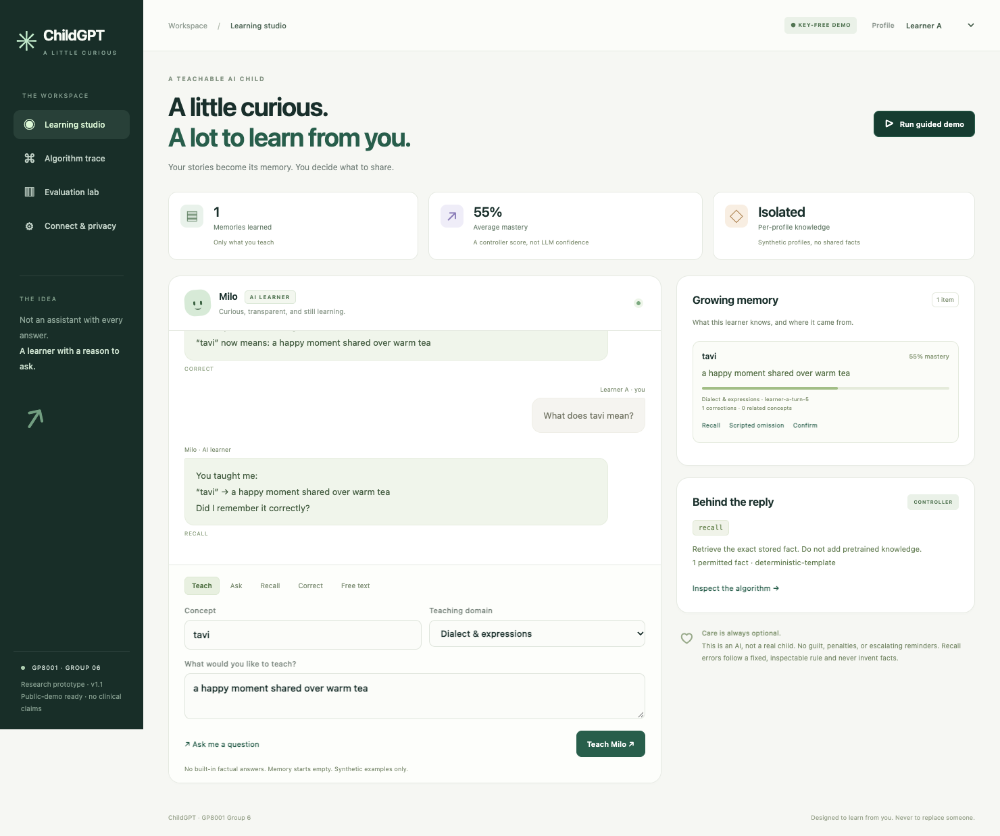

# ChildGPT · GP8001 Group 6

**可运行的课程原型，不是 PPT。** 按项目提案实现外部认知控制层（cognitive harness），并为 presentation 的 **第 3 项（方法与算法）** 和 **第 4 项（结果／模拟结果）** 提供可以操作、检查和导出的证据。

**在线演示：** https://yixuancai2004.github.io/childgpt/ ，无需 API，点 **Run guided demo** 即可。



## 最快打开

- 在线：打开上面的链接。
- 离线：用浏览器打开 **`ChildGPT-demo.html`**（运行 `npm run build` 生成）。单文件，不依赖 CDN 或外部资源。

点击 **Run guided demo**：

`未教过的问题 → 教学 → 正确回忆 → 预设遗漏 → 用户纠正 → 更新后回忆`

切换 **Learner A / Learner B** 检查记忆隔离。**Algorithm trace** 展示当次真实运行的动作、知识边界、记忆来源、掌握度、回忆决策与出错算子。**Evaluation lab** 跑测试和模拟，可下载 JSON、CSV 和图表 SVG。

这版界面是供课程演示的研究原型，尚未经过老年用户可用性验证。

## 方法与算法（第 3 项）

LLM 不决定"孩子知道什么"。控制器先决定动作和允许使用的事实，LLM（可选）只负责措辞和从用户原话中抽取片段。

| 组件 | 实现 |
|---|---|
| 记忆 | 每个用户独立的记忆：概念、内容、话题、来源回合、掌握度、修改历史、相关概念、提到过的词 |
| 知识边界 | 只从该用户的记忆作答；没教过就选 `ask_to_learn`，不用预训练知识 |
| 对话策略 | `priority = 0.5(1 − mastery) + 0.3·staleness + 0.2·topic relevance`；每 5 轮探索一次新概念 |
| 澄清 | 前后教法冲突的记忆先存为待定，策略优先追问"哪个对？"，而不是直接覆盖 |
| 好奇心 | 教学时用引号标出的词（如 “kopi”）进入好奇心队列，探索回合会主动问 |
| 关键词图 | 同一话题且共享关键词、或内容中提到对方的概念之间连边；高掌握度时据此追问联系 |
| 受控回忆 | 由掌握度决定：低 → 只提问；中 → 40% 正确 / 30% 表示不确定 / 30% 受控出错；高 → 90% 正确并追问 / 5% / 5% |
| 出错算子 | `omit_step` 漏一步、`swap_steps` 两步顺序互换、`confuse_related` 与相关概念混淆、`approximate` 只记得前半；只重排或删减已教内容，从不编造，安全敏感内容不出错，存储的记忆不变 |
| 可复现 | 抽样值 `u = hash(用户, 记忆, 回合)`，每次决定都能从 trace 重放；没有隐藏随机状态 |
| 掌握度更新 | 新教 0.35；重复 +0.10；确认 +0.15；纠正 +0.20；单纯回忆不加分 |
| 元数据与检测 | 5 个与内容无关的指标：回复率、回复延迟、回复长度、主动发起次数、纠正次数。用前 20 天建立个人基线，对加权 z 分数做单侧 CUSUM：`S_t = max(0, S_{t−1} + z_t − k)`，`S_t > h` 时报警 |

详见 [docs/IMPLEMENTATION.md](docs/IMPLEMENTATION.md)。

## 结果（第 4 项）

全部结果由 `npm run evaluate` 实际运行生成，见 [results/SUMMARY.md](results/SUMMARY.md)。

**功能控制器检查：96 / 96 通过**

| 组 | 通过 |
|---|---:|
| 知识边界（未教不答） | 20 / 20 |
| 已教内容的回忆 | 20 / 20 |
| 纠正后更新 | 10 / 10 |
| 用户隔离 | 10 / 10 |
| 受控遗漏 | 10 / 10 |
| 策略与掌握度一致 | 10 / 10 |
| 出错率校准（实测 30.4% / 计划 30%；5.0% / 5%） | 3 / 3 |
| 出错算子只用已教内容 | 10 / 10 |
| 澄清、好奇心、关键词图 | 3 / 3 |

**变化检测**（合成数据；`baselineDays=20, k=0.5, h=5, shift=1.2`，60 天，第 31 天注入变化；参数事先固定，没有为结果调参）

| 指标 | 结果 |
|---|---:|
| 稳定序列出现至少一次误报 | 40 / 200 = 20.0% |
| 变化后首次检出 | 195 / 200 = 97.5% |
| 变化前已误报 | 5 / 200 |
| 全程未报警 | 0 / 200 |
| 检出延迟（平均 / 中位数） | 4.13 天 / 3 天 |
| 只持续 3 天的短暂波动也报警 | 90 / 200 = 45.0% |

**20.0% 是整条稳定序列在 40 天监测期内至少误报一次的比例，不是每天的误报率。**

**阈值敏感性分析**：只用来展示取舍，不能在同一批数据上挑一个"最好的 h"再当成结果。

| h | 稳定序列误报 | 变化后检出 | 3 天波动报警 | 平均延迟 |
|---|---:|---:|---:|---:|
| 3 | 44.5% | 86.5% | 62.0% | 2.4 天 |
| 4 | 31.0% | 95.5% | 56.5% | 3.3 天 |
| **5（默认）** | **20.0%** | **97.5%** | **45.0%** | **4.1 天** |
| 6 | 12.0% | 98.5% | 33.0% | 5.0 天 |
| 8 | 9.0% | 98.5% | 19.0% | 6.7 天 |
| 10 | 4.5% | 98.5% | 11.0% | 8.2 天 |

**如何回应提案的问题**：老人不需要主动"求助"，只是在教 AI 孩子；系统从教学互动的节奏变化中，相对于每个人自己的基线发现变化。代价是：阈值越低，发现越快，但误报越多，短暂的情绪低落或忙碌也会触发报警。所以这个信号只适合温和地提醒家人或社工"去问候一下"，不能当作诊断。

**不能得出的结论**：脚本测试通过不代表开放式语言理解正确；没有调用真实模型；合成数据不能证明能提升参与度、减轻孤独或检测疾病。真实效果需要经过伦理审批的用户研究。

## 本地运行（前后端）

需要 Node.js 22+；**没有第三方生产依赖**。

```bash
npm start
```

浏览器打开 `http://127.0.0.1:8000`。启动时会自动构建页面。Mac 也可以双击 `Start ChildGPT.command`。

默认网页使用浏览器内的控制器，不会调用模型。要用后端，需在 **Connect & privacy** 中显式连接。

```bash
npm test          # 140 个 Node 测试：控制器、模型适配器、HTTP 会话/隔离/异常
npm run evaluate  # 96 个功能用例 + 600 条合成序列 + 阈值扫描，生成 results/
npm run build     # 输出 dist/ 和单文件 ChildGPT-demo.html
npm run check     # 依次执行以上三项
```

可选浏览器测试（需要 Python Playwright 和 Chrome/Chromium），本版本 18 / 18 通过，截图在 `results/ui/`：

```bash
python tests/browser_smoke.py --base http://127.0.0.1:8000 --chromium "/Applications/Google Chrome.app/Contents/MacOS/Google Chrome"
```

## 接入模型 API（留空）

复制 `.env.example` 为 `.env` 后自行填写。`.env` 已被 `.gitignore` 排除，不会提交：

```dotenv
LLM_BASE_URL=
LLM_API_KEY=
LLM_MODEL=
APP_ACCESS_TOKEN=
ALLOWED_ORIGINS=
```

- `LLM_BASE_URL` 填兼容 Chat Completions 的前缀（通常含 `/v1`），模型需要支持 JSON 输出。三项 LLM 字段要么都填，要么都空。
- `APP_ACCESS_TOKEN` 是另外生成的应用口令，**不是模型密钥**；接入真实模型时至少 24 个字符。
- 模型只做两件事：从用户原话中抽取**原文片段**（会校验确实是原文的子串），以及从预先批准的措辞里选一句。事实内容始终来自该用户的记忆；出错、超时或不合法输出时，会明确退回确定性模板。
- 真实模型调用尚未验证。`tests/llm.test.mjs` 使用的是标注为模拟的提供商。

GitHub Pages 只托管静态页面，不运行 Node 后端。远程后端需要 HTTPS，并设置 `ALLOWED_ORIGINS=https://yixuancai2004.github.io`。

## 文件结构

```text
src/core.js             浏览器和后端共用的确定性控制器、CUSUM、合成实验
src/llm.mjs             服务端模型适配：原文片段验证、受限措辞
server.mjs              Node HTTP 后端：会话隔离、文件持久化、CORS、限流
web/                    前端源文件
scripts/                构建、评估、发布脚本
tests/                  控制器、API、HTTP 和可选浏览器测试
results/                实际运行生成的 JSON、CSV、摘要与界面截图
docs/IMPLEMENTATION.md  与提案逐项对应的实现说明
docs/HANDOFF.md         给负责展示的组员：演示与取结果步骤
.github/workflows/      测试与 Pages 自动部署
```

## 重要边界

- 记忆从空白开始，示例都是虚构资料。浏览器本地保存默认关闭。
- Learner A / B 只是演示分区，不是登录系统；后端用随机 bearer token 隔离访问者，但未经生产级安全审计。
- 安全敏感内容用关键词拦截，不出错；关键词拦截并不是通用的内容安全系统。
- 掌握度增量、出错概率、检测权重和数据生成分布都是本原型自行设定的示例参数，不是经过验证的数值。

## 参考

- [NIST: CUSUM control charts](https://www.itl.nist.gov/div898/handbook/pmc/section3/pmc323.htm)
- [GitHub Pages: custom workflows](https://docs.github.com/en/pages/getting-started-with-github-pages/using-custom-workflows-with-github-pages)
